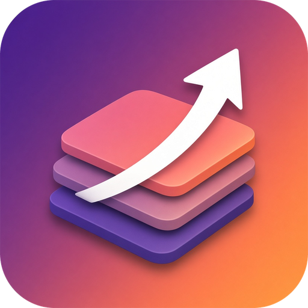
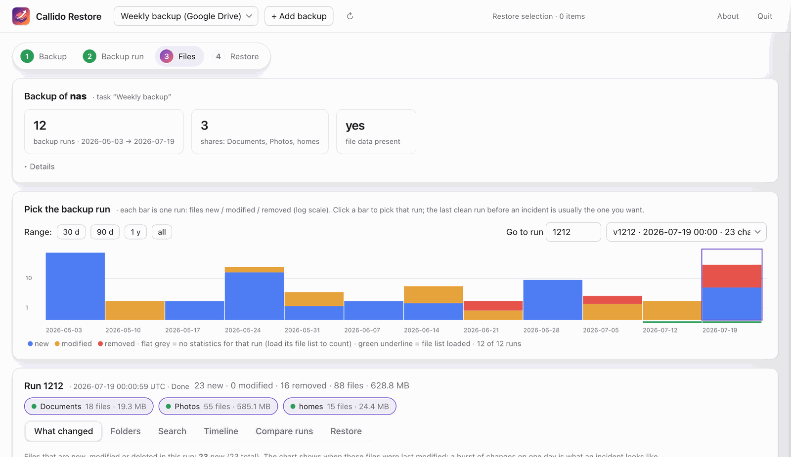
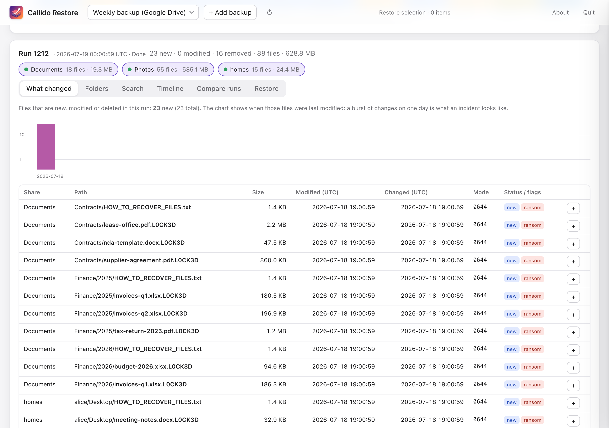
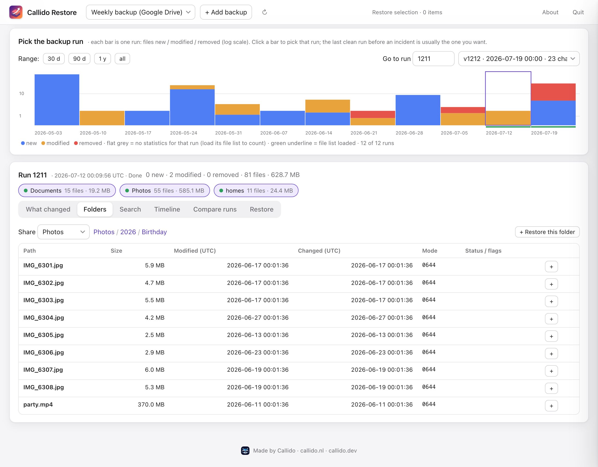
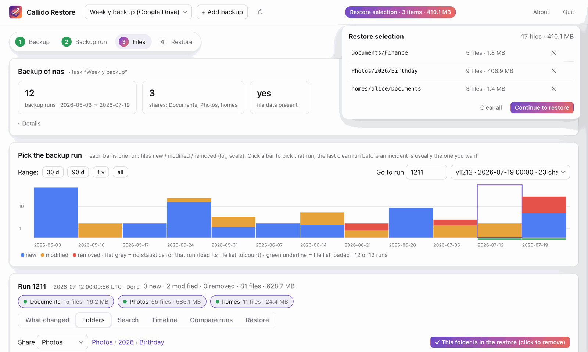
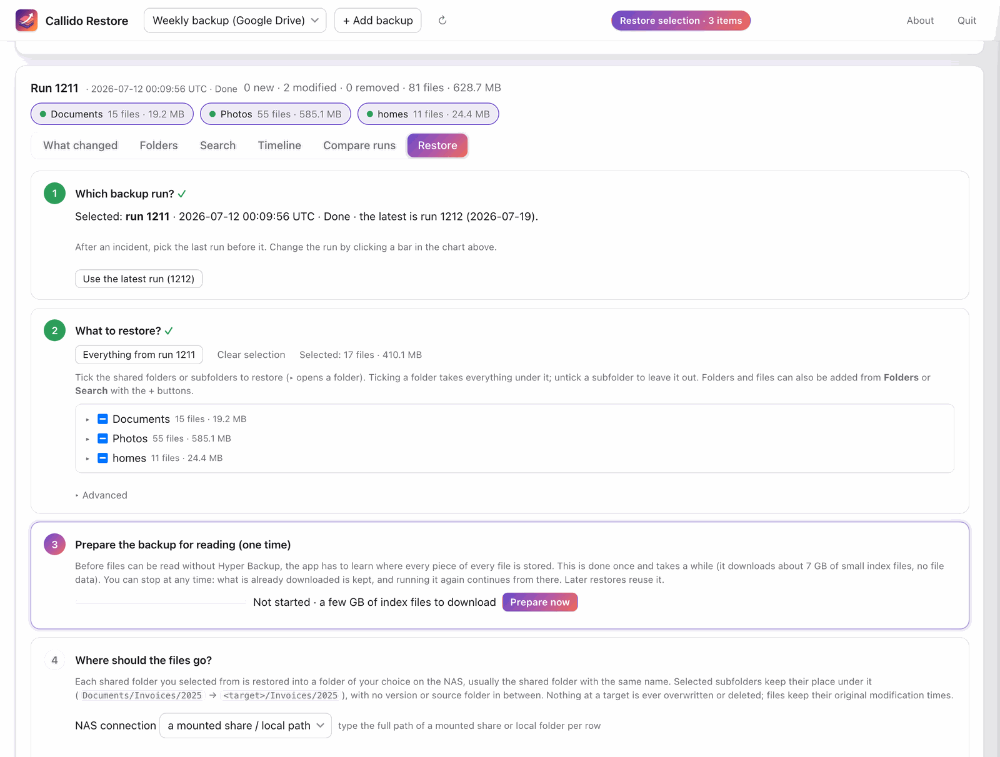

# Callido Restore (macOS and Windows)

Restore Synology Hyper Backup (.hbk) files.

 

Browse a Synology **Hyper Backup** (`.hbk`) on a timeline and restore files from it **without** Hyper Backup or a working NAS.
Works on a `.hbk` that sits on Google Drive (or any rclone remote), on a NAS share over SMB, or on a local disk, complete or partial.
Built after a ransomware incident; the backup's own metadata databases are read directly, only the data you restore is downloaded.

## How it looks

Every backup run on a timeline: files new, modified and removed per run. A burst of red and blue at the end is what an incident looks like.

<table>
<tr>
<td width="50%"><b>What changed in a run.</b> Encrypted copies and ransom notes are flagged. </td>
<td width="50%"><b>Browse the last clean run</b> and add folders or single files to the restore. </td>
</tr>
<tr>
<td width="50%"><b>Restore selection.</b> Always visible, with file counts and sizes, items can be removed again. </td>
<td width="50%"><b>Restore wizard.</b> Run, selection, one-time preparation, one target folder per shared folder. </td>
</tr>
</table>

The pictures show a small demo backup (`scripts/make_demo_backup.py`); `scripts/screenshots.py` regenerates them.

## Product goal

A macOS and Windows app anyone can use to restore a Synology Hyper Backup (`.hbk`) without Hyper Backup.
Google Drive is the first source; other sources come later. macOS (Apple silicon and Intel) and Windows 10/11 (x64) are built from the same code.

1. A wizard sets up access to the source: rclone Google Drive auth, including your own Google client id and secret (rclone's shared client id is being retired).
2. Pick the backup, then browse a timeline per folder. The latest run (highest version id, regardless of status) is selected by default; pick the last clean run before an incident.
3. Select the folders to restore.
4. Restore to a destination on a NAS, into a new/empty folder; existing NAS data is never overwritten or deleted. A wizard explains how to prepare the NAS: an SMB share, a user and its permissions, or another protocol.

Packaging as a `.app` / `.dmg` ([T3](docs/TASKS.md)) and a Windows `.msi` ([T14](docs/TASKS.md), [docs/WINDOWS.md](docs/WINDOWS.md)) is what makes it usable by everyone.

**Portability:** avoid needless macOS-only choices (hardcoded paths, `/Volumes` assumptions, macOS-only packaging steps) so a Windows build stays feasible.

* Timeline of every backup run (new/modified/removed), per-run changes, file timeline by mtime/ctime, folder browser, search with
  suspicious-file flags, version compare, single-file download.
* Restore wizard: pick a run, pick everything or folders, choose the target (back into the original NAS shares (existing files are skipped, never overwritten), a folder on a share,
  or a local path). Files already at the target are skipped, never overwritten or deleted, and a target inside the backup is refused. Resilient: retries, parallel prefetch, pause/resume, survives restarts.
* Detects ransomware-encrypted copies (`.L0CK3D`) and reports them as unreadable.

Requires no client-side encryption on the backup task (encrypted tasks are not supported yet).

## Install

**macOS** (Apple silicon: `CallidoRestore-arm64.dmg`, Intel: `CallidoRestore-amd64.dmg`): download the `.dmg` from
[Releases](https://github.com/Niels-van-Haren-Holding-B-V/callido-restore/releases), drag the app to Applications and open it.
The app is not notarized, so macOS blocks the first start: on macOS 15 and later click *Done*, then go to System Settings →
Privacy & Security and click *Open Anyway*; on older macOS right-click the app → Open.

**Windows 10 and 11** (x64; Windows on Arm runs it through emulation): download `CallidoRestore-x64.msi` from
[Releases](https://github.com/Niels-van-Haren-Holding-B-V/callido-restore/releases), save it on the PC's own disk (not a network
or VM shared folder: Windows Installer cannot open it there) and double-click it. The installer is not code-signed yet, so
SmartScreen shows "Windows protected your PC": click *More info* → *Run anyway*. Compare the file with
`CallidoRestore-x64.msi.sha256` first if you like (`Get-FileHash CallidoRestore-x64.msi`). The app installs to
`C:\Program Files\Callido\Callido Restore` with a Start menu and desktop shortcut, opens in its own window (Microsoft Edge
WebView2, built into Windows 11 and current Windows 10) and is removed under Settings → Apps.

Settings, caches and `app.log` live in `~/.hbk-explorer/` (on Windows `%USERPROFILE%\.hbk-explorer`); uninstalling keeps them.
Or from source: `python3 -m venv .venv && .venv/bin/pip install -r requirements.txt && .venv/bin/python -m callido_restore` (opens the app
window; add `--browser` to use your browser instead).
`rclone` is bundled in the app (MIT; `rclone-COPYING` and `THIRD-PARTY-NOTICES.txt` are inside the app under `Contents/Resources/Licenses/` and on the disk image, on Windows under `_internal\Licenses\` in the install folder). From source, install rclone with Homebrew (macOS) or `winget install Rclone.Rclone` (Windows).
The logo is original artwork made for this project (see `assets/README.md`); the app is not affiliated with Synology.

## Docs
`docs/USER-GUIDE.md`, `docs/FORMAT.md` (the reverse-engineered format), `docs/ARCHITECTURE.md`, `docs/HANDOVER.md`, `docs/TASKS.md`.

MIT licensed. Not affiliated with or endorsed by Synology. Hyper Backup is a trademark of Synology Inc.

Made by [Callido](https://callido.nl) · [callido.nl](https://callido.nl) · [callido.dev](https://callido.dev)
