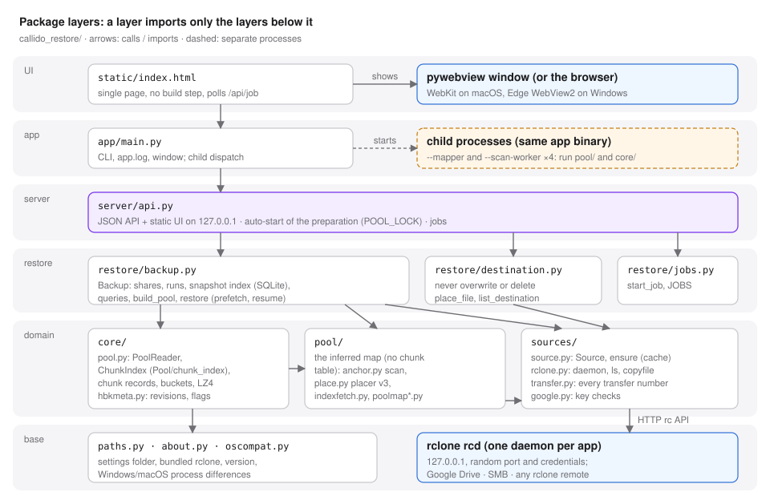
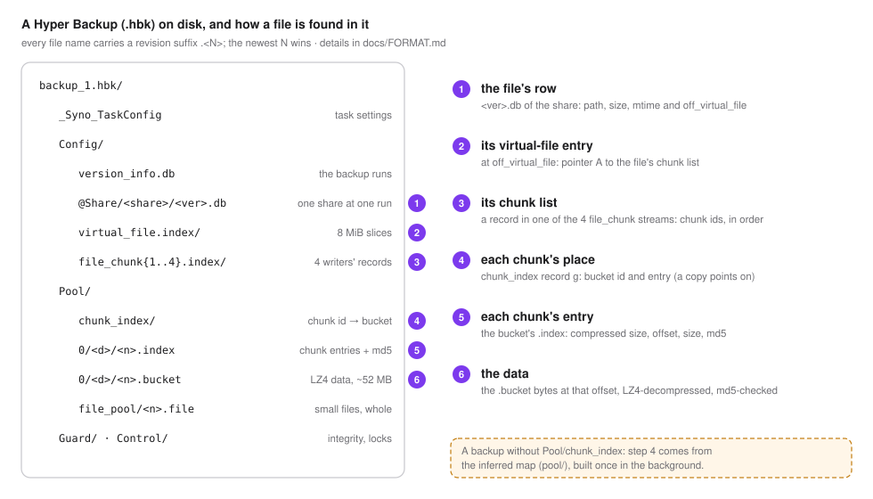
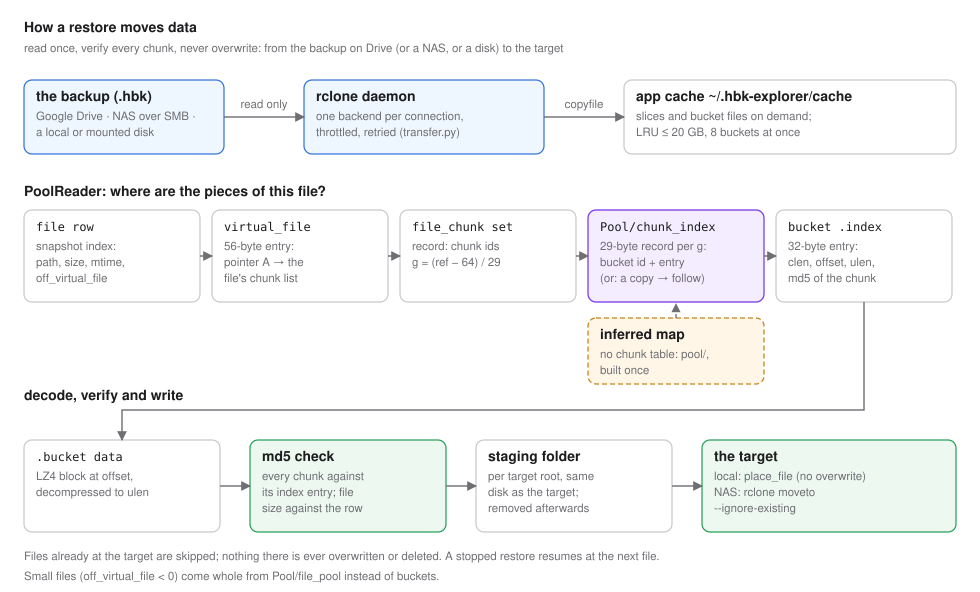

# Architecture

Package `callido_restore/`, one folder per layer; a layer never imports a higher one, `tests/` mirrors the layers.
The diagrams are generated by `scripts/make_diagrams.py` (plain SVG, light and dark).

## Layers

* `paths.py` — where things live: `~/.hbk-explorer/` (`sources.json`, `index/`, `cache/`, `jobs/`), bundled resources (`static/`,
  rclone) in a checkout or a PyInstaller bundle, the `RCLONE` binary, local-versus-remote path rules (`is_remote_path`, Windows drive
  letters are local). Code reads the folders through the module (`paths.INDEX_DIR`), so tests point them at a temp folder.
  `about.py` — `APP_NAME`, tagline, notice, `VERSION` (build scripts read them; `pyproject.toml` must match, a test checks it).
  `oscompat.py` — the few process differences between macOS and Windows (`popen_kw`, process groups).
* `core/` — the .hbk format, pure parsing: `pool.py` (sliced streams, virtual file index, chunk records, `ChunkIndex` for
  `Pool/chunk_index`, buckets, LZ4, `PoolReader` that plans and reconstructs files), `hbkmeta.py` (file revisions, share-root id,
  ransomware markers, flag extension sets).
* `pool/` — the inferred map, for backups without `Pool/chunk_index`: `anchor.py` (anchor scan: tagged records located in the bucket
  indexes, up to four worker processes), `place.py` (placer v3: phantom copies, stream-offset pins, byte-and-count partition, every
  sized record verified), `poolmap.py` (the child-process wrapper `build_poolmap_detached`, `build_map`, the v1 search kept for
  comparisons), `poolmap2.py` (writer tables), `indexfetch.py` (resumable bucket-index download, 64 parallel transfers).
* `sources/` — where the backup and the targets are: `source.py` (`Source`: a local .hbk folder plus optional rclone remotes and
  extra read-only roots; `ensure` downloads a missing file into `cache/<source>/` only, nothing in a source is ever modified;
  persisted folder listings; the registry `SOURCES`), `rclone.py` (one `rclone rcd` daemon per app on 127.0.0.1 with a random port
  and credentials; `ls` through one backend per connection, `copyfile` with live bytes, `config_create`/`config_update`,
  `authorize_drive`; a subprocess fallback; orphaned helpers of a crashed app are stopped at start), `transfer.py` (the one place for
  every transfer number: shared resilience and Drive pacing, a profile per kind of work, with the measurements behind them),
  `google.py` (Google client id and secret checks before the sign-in).
* `restore/` — `backup.py` (`Backup`: task, shares and runs; the derived SQLite snapshot index; queries for the explorer tabs;
  `build_pool` (the preparation) and `pool_status`; `restore_plan`/`restore` with prefetch, LRU cache, retries, persisted and
  resumable jobs, per-file verified / identical-copy / unverified counts), `destination.py` (never overwrite or delete: `place_file`,
  per-folder targets, `restore_target_error`, `list_destination`), `jobs.py` (`start_job`, `JOBS`).
* `server/api.py` — the JSON API and the static UI on 127.0.0.1 (`H`), thin handlers over `sources` and `restore`; the `backup_for`
  registry; the auto-start of the preparation (`maybe_autoprepare`, one `POOL_LOCK` for check-and-start, a persisted pause).
* `app/main.py` — command line, `app.log` when frozen, the pywebview window, and the child dispatch: the same app binary runs as the
  pool mapper (`--mapper`) or as an anchor-scan worker (`--scan-worker`), so a packaged app needs no Python on the machine.
  `callido_restore/__main__.py` is the entry point (`python -m callido_restore`) and the PyInstaller script.
* `static/index.html` — single-page UI, no build step, no external dependencies.

## The backup on disk

A file's row in the snapshot of its share gives `off_virtual_file`; the virtual-file entry there points (pointer A) at the file's
chunk list in one of the four `file_chunk` streams; each chunk id `g` has a 29-byte record in `Pool/chunk_index` with its bucket and
entry (or, for a copy that stored nothing, the record it shares); the bucket's `.index` entry gives offset, sizes and md5; the
`.bucket` holds the LZ4 block. Small files (`off_virtual_file < 0`) are stored whole in `Pool/file_pool`. Details: `docs/FORMAT.md`.

## A restore

* **Opening a backup** (`/api/open`, a job with step messages): `Backup` lists the top level, the shares and their snapshots through
  `Source.listdir` (persisted listings, one rclone backend per connection) and reads the run list.
* **Loading a share** (`/api/index`, a job): the share's raw `<ver>.db` snapshot is fetched once and turned into a derived SQLite with
  resolved paths and flags; the timeline, search and compare tabs query it.
* **Preparation** (`build_pool`, started by itself after an open or a share load, `/api/pool` reports `running`, `paused`,
  `complete`): nothing to do when the backup has `Pool/chunk_index` (`complete` at once). Without it: the four chunk-record sets,
  record sizes and tags, the bucket indexes (5-7 GB on a real backup, resumable), then the inferred map in a child process
  (anchor scan with four workers, then the placer); Stop ends the child and its workers at once.
* **Restore** (`POST /api/restore`, a job): `restore_plan` (rows) → `PoolReader` per file (chunk table, or the inferred map) →
  bucket data fetched ahead of the writer, several at a time (the `restore` profile in `transfer.py`), LZ4 decoded, every chunk md5-checked → a per-root staging folder →
  `place_file` (local) or `rclone moveto --ignore-existing` (NAS). Buckets are evicted LRU (≤ `HBK_CACHE_GB`, default 20). The job is
  persisted as it goes; pause is a cancel flag; `/api/restore/resume` restarts at `next_index`, carries the counts forward and skips
  files already at the target.

## API

All GET unless noted. Backups: `/api/sources`, `POST /api/sources`, `/api/sources/delete`, `/api/open` (job), `/api/snapshot_info`,
`/api/index` (job), `/api/query`, `/api/children`, `/api/histogram`, `/api/file`, `/api/diff`, `/api/extract`, `/api/download`, `/api/ls`.
Preparation: `/api/pool`, `/api/pool/build` (job), `POST /api/pool/pause`, `POST /api/pool/resume`. Restore: `/api/restore_plan`,
`/api/restore_count`, `/api/dest/check`, `POST /api/restore` (job), `POST /api/restore/resume`. Jobs: `/api/job`, `/api/jobs`,
`/api/jobs/saved`, `/api/job/cancel`. Connections: `/api/remotes` (types, own-key flags, SMB address and user, never a secret),
`/api/rclone/ls`, `POST /api/rclone/connect` (job; Google sign-in or SMB, an existing name is updated in place). App: `/api/about`,
`/api/quit`.
