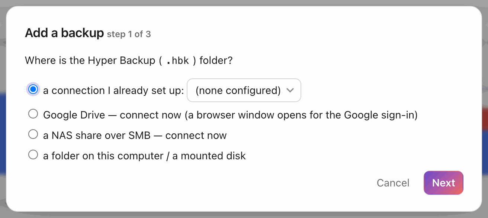
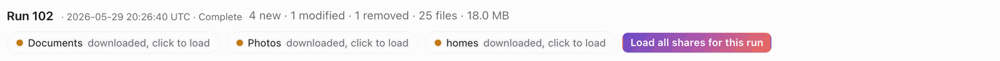
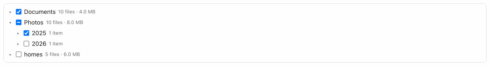
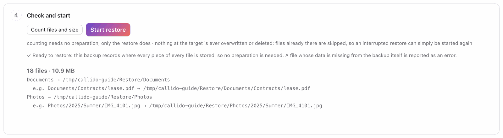
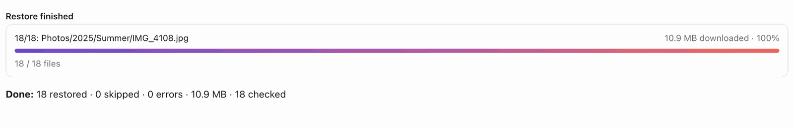
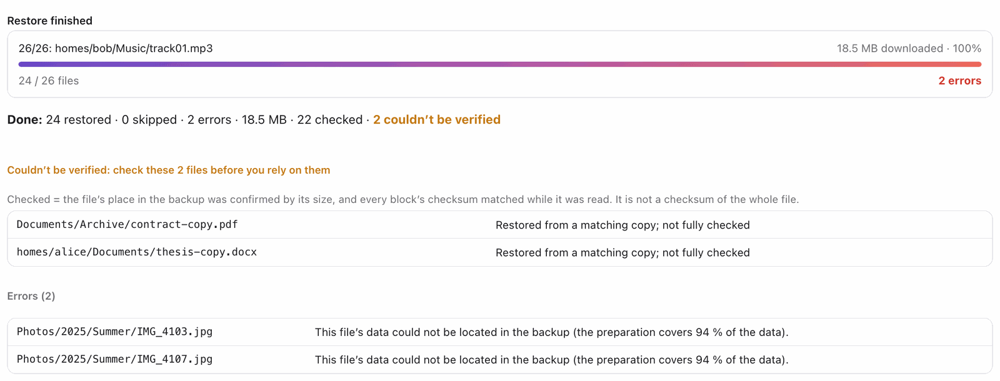

# User guide

1. Start the app (or `python3 -m callido_restore` from a checkout). It opens its own window; the UI is served on http://127.0.0.1:8765 only on this
   machine. Closing the window stops the app (running restores are saved and can be resumed). `--browser` opens the UI in your
   browser instead; `--no-window` runs only the server.
2. **+ Add backup** → choose where the `.hbk` lives: an rclone remote you already have, Google Drive (sign in; with or without a
   Google key of your own, see "Google Drive: a key of your own" below), a NAS over SMB, or a local folder → browse to the `.hbk`
   folder → name it.

   

3. The overview shows the task, the shares and all backup runs. Click a run in the chart (or type its number in "Go to run"); the
   latest run is selected by default. Each shared folder of a run has its own file list: click a chip to load it, or **Load all shares
   for this run** (a few MB each). The chip then shows the number of files and their size.

   

4. Tabs: **What changed** (what that run added, changed or removed, with ransomware flags), **Folders**, **Search**, **Timeline**,
   **Compare runs** and **Restore**.
5. **Restore**, in four steps:
   * **Which backup run?** After an incident, pick the last run before it.
   * **What to restore?** Tick shared folders or subfolders in the tree (▸ opens a folder; ticking a folder takes everything under
     it; untick a subfolder to leave it out). The selected file count and size update as you go. Folders and files can also be added
     with the + buttons under Folders or Search. A shared folder whose file list is not loaded yet loads when you tick it.

     

   * **Where should the files go?** One row per selected shared folder, defaulting to the NAS share with the same name: the
     folder's contents land there directly, with no version or source folder in between. Pick another share or sub-folder per row,
     or choose "a mounted share / local path" as the connection and type a path per row. "Advanced" can put everything under one
     folder as `<folder>/<share>/<path>` instead. No NAS connection yet? Open "Prepare the NAS and connect": it explains the shared
     folder, user and SMB settings and connects from there. "Check targets and preview" tells you per row whether the folder is new,
     empty or already has files, and shows one sample file with its final path; a folder inside the backup itself (or around it) is
     refused.
   * **Check and start.** "Count files and size" shows what will be restored and where. A backup that carries its own chunk table (the
     usual case) records where every piece of every file is stored, so it is ready to restore at once:

     

     A backup without that record needs a one-time preparation first (the app downloads the backup's index files and builds a
     map; it starts by itself and shows its progress on one line). You can press **Start when the backup is prepared**: the
     restore then starts by itself as soon as the preparation is done.
   * **The result.** The bar shows the restore while it runs, with **Stop**: the restore stops within seconds and keeps its
     progress, and **Resume** goes on with the next file. A restore cut short by a closed app, a crash or a restart is listed under
     "Restores you can resume" with the same **Resume** button. When it ends, one line sums it up: restored, skipped (already at the target), errors, size, and how many files were
     **checked** (the file's place in the backup was confirmed and every block's checksum matched while it was read). Files that
     **couldn't be verified** were restored, but check them before you rely on them; files that could not be restored at all are
     listed under **Errors**. From a backup that carries its own chunk table, every file is checked:

     

     A backup restored through the preparation's map can leave some files unverified or unrestored; both are listed:

     

   Files already at the target are never overwritten or deleted. During a restore to a local folder, files are staged in a hidden
   `.hbk-restore-<job id>-…` folder inside the target and moved into place one by one; it is removed when the job ends or is resumed.
   If the app was killed mid-restore, that folder may remain; it is safe to delete.

The pictures show synthetic backups with made-up names; `scripts/guide_screenshots.py` regenerates them.

Encrypted (`.L0CK3D`) copies are detected and reported as unreadable.

## A restore to the NAS that was interrupted
Each file is uploaded to the NAS under a temporary name, `<name>.callido-restore.part`, and renamed on the NAS only when it is
complete, never over a file that is there. So a file under its real name is always whole, also on NAS connections that write
in place (WebDAV, for example). An upload that was cut off (Stop, a dropped connection, a closed app, or one the app ended
because nothing moved for 10 minutes) leaves only that temporary name. Resume uploads the file again, and the check at the end
of the restore deletes the app's own `.callido-restore.part` files of the restored folders. It deletes nothing else on the NAS.
rclone's own `<name>.<code>.partial` files (from version 1.2.0 and older) are counted in the result line; remove them yourself
in File Station (search for `.partial`).

A file that is already at the target with the size the backup gives is skipped. A file with another size is kept as it is
and listed under Errors: it may be the start of an interrupted copy made by another tool or an older version. Delete it if it
is incomplete, and restore again.

## Settings

**⚙** in the header opens the settings; nothing else on the screens moves (**+ Add backup** stays where it is):
* **NAS**: *Edit* changes a NAS connection's address, port, user or password and tests it. The name stays, so backups and restore
  targets keep working, for example when you switch between the NAS's local address at home and its Tailscale address elsewhere.
* **Google Drive**: whether your own Google key is in use, *Add your own key* / *Replace key* (the steps below), and *Sign in
  again* when Google asks for it; signing in again keeps your own key.
* **Appearance**: follow the system, light or dark; remembered on this computer.
* **Updates**: install updates automatically (never while a restore or a preparation runs), only mention them (the default: a
  notice in the header, you choose when), or don't check; *Check now*.
* **Download cache**: where it is, how much it holds, and *Clear the cache* (not while anything runs). Clearing never undoes the
  file lists or the preparation; whatever is needed is downloaded again.

## Google Drive: a key of your own (optional, recommended)

Google does not limit how fast you download, it limits how many *requests* an app may make per second. Without a key of your own
the app signs in through the public key of rclone, which every rclone user in the world shares, so Google slows it down. A backup
is tens of thousands of small index files, one request each: that is what turns the one-time preparation into hours. With your own
key the limit is yours alone, and the Google sign-in screen shows your own project name instead of "rclone". Everything works
without a key; it is only slower.

Getting one is free and takes about five minutes (the same steps are in the app, under *Add backup*):

1. Open console.cloud.google.com with the Google account that holds the backup and create a project (any name).
2. *APIs & Services → Library*: enable "Google Drive API".
3. *APIs & Services → OAuth consent screen*: user type *External*, app name "Callido Restore", your e-mail as contact; under
   *Test users* add your own account (the app stays in testing mode, which is fine for one user).
4. *APIs & Services → Credentials → Create credentials → OAuth client ID*, application type *Desktop app*.
5. Copy the Client ID and the Client secret into the app: either when you connect Google Drive, or later under *Add backup →
   a connection I already set up → Downloads slow? Give this Google Drive connection a key of your own*. The connection keeps its
   name, so your backups and everything already downloaded stay; you sign in to Google once more.

The key identifies the app towards Google and gives nobody access to your Drive. It is stored in rclone's configuration on this
computer together with the sign-in token.

## Disk space on this computer
Nothing is ever written to the backup. What the app downloads goes into its own cache folder (`~/.hbk-explorer/cache`):
the backup's chunk table (`Pool/chunk_index`, read in 8 MB slices as a restore needs them; up to the table's full size,
6.8 GB for a 1.5 TB backup, and kept for later restores), the snapshot file lists you load, and the bucket files a restore
reads. Bucket files only pass through: once the cache holds more than 5 GB of them, the ones the next files do not need are
deleted, and a finished restore deletes them all (a stopped one keeps them for Resume). You can delete the cache folder when
the app is closed; it is filled again on demand.

## The check at the end of a restore
When a restore has gone through all files, the app checks the target: every file of the restore must be there with the size
the backup gives. Files that are missing are restored again (twice at most; when the NAS refused an upload, after waiting two
minutes, because the NAS had the file in use). The result line says how many files are at the target, how many were
restored again and how many are still missing or have another size; those stay in the error list. A Stop during the check
resumes with the check.
